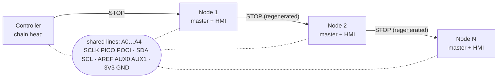
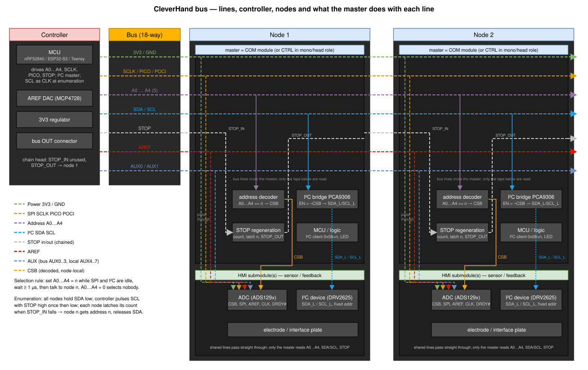
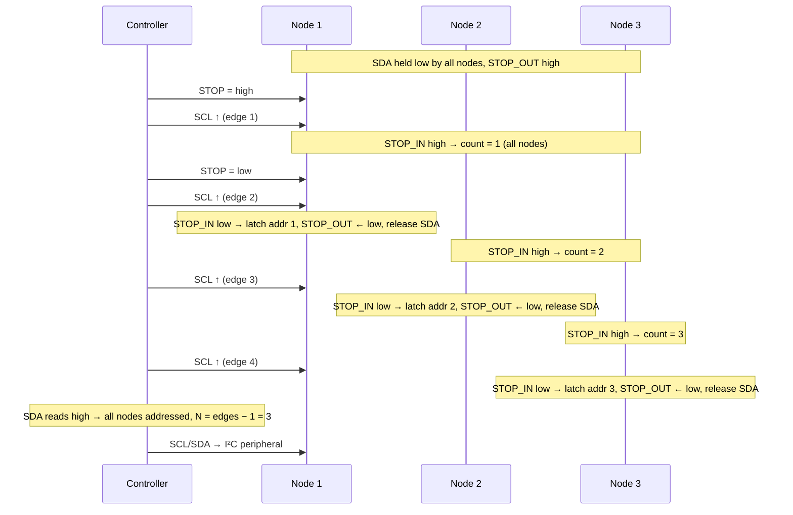
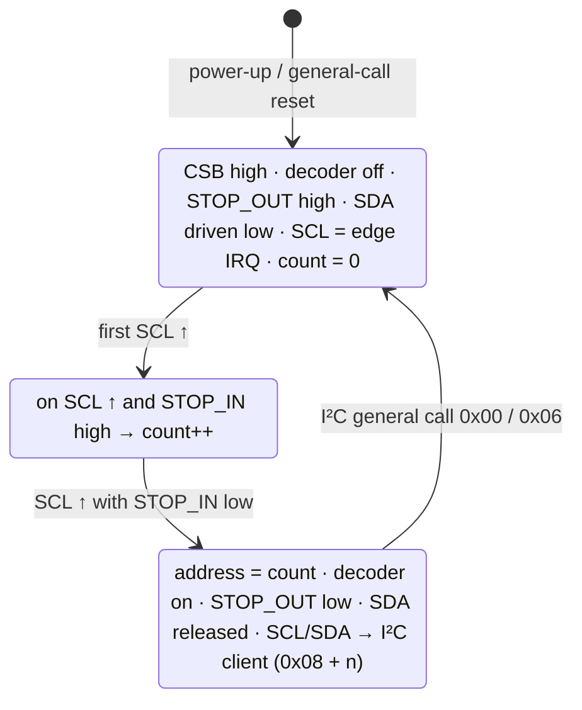
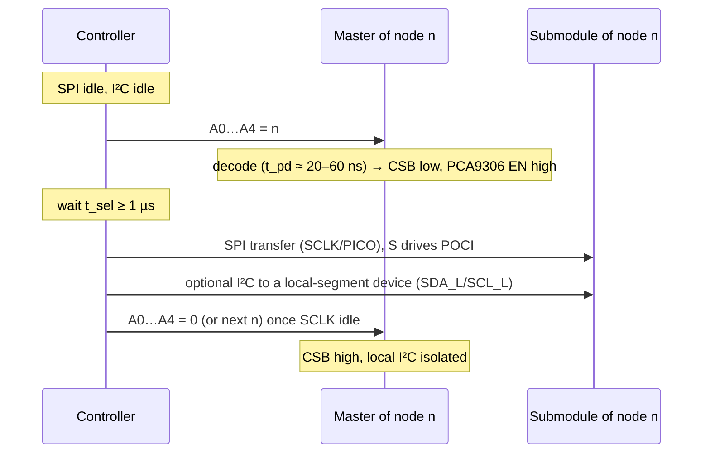

# CleverHand Bus (CHB) — specification

This document describes the CleverHand bus: the lines it carries, how nodes get
their address from their position in the chain, and how the controller talks to
the submodules of each node. It is the reference for anyone designing a
controller, a communication module or a submodule.

Two revisions are covered:

| Revision | Status | Summary |
| --- | :---: | --- |
| **v2** | implemented (`COM_MOD`, `S_*` shields, `hc32l110_clvhd` firmware) | 18-way 0.5 mm FPC, 5-bit parallel address bus, shared I²C |
| **v3** | planned (this design iteration) | separable bus connector, per-node I²C bridge, NeoPixel chain, address bus form to be decided |

Where v3 differs from v2 it is marked **[v3]**. Everything unmarked applies to both.

---

## 1. Principles

1. **One controller, N nodes, one chain.** The controller sits at the head of the
   chain. Each node has an IN and an OUT connector; every line passes straight
   through the node except the *chained* lines (§3.4), which are regenerated by
   each node.
2. **No hard-coded identity.** Every node PCB and every firmware image is
   identical. A node learns its address from its **position in the chain** during
   enumeration (§4). Swapping two nodes swaps their addresses; nothing has to be
   reprogrammed.
3. **Address = position, 1-based.** The node closest to the controller is
   address 1. Address 0 means *no node selected* and must never match a node.
4. **One selected node at a time.** The controller drives the address; only the
   matching node asserts its chip-select and connects its local I²C segment
   **[v3]**. All other nodes are electrically passive on SPI and local I²C.
5. **Bus stays passive at power-up.** Until a node has been addressed it keeps
   CSB high and its I²C bridge open, so an un-enumerated chain never drives the
   shared lines except the deliberate SDA-low "not ready" signal (§4.3).

---

## 2. Topology

```
                 ┌──────────┐   ┌──────────┐   ┌──────────┐
 ┌────────────┐  │  node 1  │   │  node 2  │   │  node N  │
 │ controller │  │ ┌──────┐ │   │ ┌──────┐ │   │ ┌──────┐ │
 │            ├──┤ │ COM  │ ├───┤ │ COM  │ ├─ ─┤ │ COM  │ │
 │  (head)    │  │ └──┬───┘ │   │ └──┬───┘ │   │ └──┬───┘ │
 └────────────┘  │  ┌─┴──┐  │   │  ┌─┴──┐  │   │  ┌─┴──┐  │
                 │  │ sub│  │   │  │ sub│  │   │  │ sub│  │
                 │  └────┘  │   │  └────┘  │   │  └────┘  │
                 └──────────┘   └──────────┘   └──────────┘
   shared lines  ═══════════════════════════════════════════  (pass-through)
   chained lines ──►[COM]──►──────►[COM]──►──────►[COM]──►     (regenerated)
```





Roles:

| Role | Board(s) | Responsibility |
| --- | --- | --- |
| **Controller** | `S_TEENSY4`, `S_PICO`, `S_XIAO`, `MONO_CTRL`, future nRF52840 / ESP32-S3 boards | Bus master: enumeration, address, SPI/I²C master, AREF, LED data |
| **Communication module (COM)** | `COM_MOD` (v2), `COM_MOD` A/B (v3) | Per-node: counts its position, decodes the address into CSB, gates the local I²C segment **[v3]**, forwards the chained lines |
| **Submodule** | `EMG_DAQ_*`, `IMU_*`, `VIB_*`, `FES_*`, … | Consumer of CSB, SPI, local I²C, AREF and power. Never touches the address or chained lines |

A node is a stack: COM module on top of one or more submodules, connected by the
1.27 mm **stack interface** (§3.6). The bus itself only enters the COM module.


**Mono configuration.** A controller with the stack interface on its underside
(`MONO_CTRL`, planned nRF/ESP boards) sits directly on the submodules with no COM
module and no bus: it drives CSB and the local I²C itself. The submodules cannot
tell the difference.

---

## 3. Lines

### 3.1 Groups

| Group | Lines | Kind | Notes |
| --- | --- | --- | --- |
| Power | `3V3`, `GND` | shared | 3.3 V logic and analog pre-regulator rail, see §7 |
| SPI | `SCLK`, `PICO`, `POCI` | shared | Controller is master. Only the selected node's submodule drives `POCI` |
| I²C | `SDA`, `SCL` | shared | 3.3 V, pull-ups on the controller. `SCL` doubles as the enumeration clock (§4) |
| Address | `A0`…`A4` (v2) | shared | 5-bit parallel, driven by the controller. Form under review for v3 (§8.3) |
| Chain | `STOP` | chained | Enumeration stop token: `STOP_IN` from the previous node, `STOP_OUT` to the next |
| NeoPixel **[v3]** | `LED` | chained | WS2812 data: `LED_IN` → node LEDs → `LED_OUT` |
| Analog AUX | `AREF`, `AUX1`…`AUX3`, `IO2` | shared | External ADC reference from the controller DAC; the four spare lines reach the v3 stack as `AUX0`…`AUX3` |

### 3.2 v2 connector pinout (18-way 0.5 mm FPC, `FPC-05F-18PH20` / `XF2J-1824`)

Pin numbers below are those of the **IN** connector on a node and of the OUT
connector on a controller shield. The node's OUT connector is pin-reversed
(pin 1 = `AREF` … pin 18 = `AUX1`) so that a plain same-side 18-way FFC links
OUT to the next IN.

| Pin | Line | Dir (node) | Group | Pin | Line | Dir (node) | Group |
| --: | --- | :-: | --- | --: | --- | :-: | --- |
| 1 | `AUX1` | – | AUX | 10 | `POCI` | out | SPI |
| 2 | `3V3` | in | Power | 11 | `PICO` | in | SPI |
| 3 | `GND` | – | Power | 12 | `SCLK` | in | SPI |
| 4 | `AUX3` | – | AUX | 13 | `STOP` | in (regenerated on OUT) | Chain |
| 5 | `A0` | in | Address | 14 | `IO2` | – | AUX (wired to a SYNC header on `S_XIAO`) |
| 6 | `A1` | in | Address | 15 | `SDA` | bidir | I²C |
| 7 | `A2` | in | Address | 16 | `SCL` | in | I²C |
| 8 | `A3` | in | Address | 17 | `AUX2` | – | AUX |
| 9 | `A4` | in | Address | 18 | `AREF` | in | AUX |

Connector shield tabs (19, 20) are `GND`.

### 3.3 Electrical conventions

| Item | Value |
| --- | --- |
| Logic level | 3.3 V CMOS. No 5 V-tolerant line |
| `CSB` (stack) | active low, pulled up to `3V3` on the COM module so it is high before configuration |
| `SDA`/`SCL` | open-drain, pull-ups on the controller (4.7 kΩ typ.). A node may **drive** `SDA` low only during enumeration (§4.3) |
| `A0`…`A4` | push-pull from the controller, idle `00000` |
| `STOP` | push-pull from the previous stage, idle **high** (= "keep counting") |
| `POCI` | tri-state; a submodule must release it when its CSB is high (ADS129x DOUT does) |
| `AREF` | buffered analog, 0…3.3 V, from the controller DAC (`MCP4728` on the shields) |
| SPI mode | set by the submodule: ADS1293 mode 0, ADS1292/1298 mode 1 (SCLK idles low in both) |

### 3.4 Chained lines

A chained line is *not* passed through. The COM module receives it on the IN
connector and drives a new copy on the OUT connector.

- **`STOP`** carries the enumeration token (§4). Idle high. A node pulls its
  `STOP_OUT` low once it has latched its own address and keeps it low until
  re-enumeration.
Chained lines are what tie the protocol to the connector: they need a
break between consecutive nodes, which two-connector schemes (FPC IN/OUT,
flex bracelet) provide and a single mid-ribbon IDC tap does not (§8.10).

- **`LED` [v3]** carries the WS2812 bit-stream. The node's own LEDs are inserted
  in the chain, so the controller sees one long strip whose LED index follows
  the node order: with *k* LEDs per node, node *n* owns indices
  `k·(n−1) … k·n−1`. Every WS2812 re-times the stream, so chain length is not a
  signal-integrity concern. In v2 the LEDs are driven locally by the COM MCU and
  only reachable through I²C; v3 moves them to the bus so the controller can
  update all LEDs with one stream and the mono configuration has LEDs at all.

### 3.5 Analog AUX

- **`AREF`** is the shared external reference for the acquisition submodules.
  Route it away from `SCLK`/`PICO` and decouple it on each submodule (series
  10 Ω + 1 µF is enough). Its use is submodule-specific: `EMG_DAQ_ADS1293` selects
  it with solder jumpers.
- **`AUX1`…`AUX3`, `IO2`** are uncommitted lines that reach the stack interface.
  Nothing on the v2 chain drives them by default. Proposed v3 assignment: one of
  them becomes a shared open-drain **`DRDY#`/`IRQ#`** so the controller can wait
  for the ADCs instead of polling (§8.4).

### 3.6 Stack interface (intra-node)

> The v3 intra-node interface is a single soldered **3×10 1.27 mm field of plated
> holes** shared by the bus board, the master (COM or CTRL) and the HMI boards:
> row A is the v2 submodule row, row B the bus side, row C the local I²C and
> eight AUX lines. It is specified in [interfaces.md](interfaces.md). The rest of
> this section describes v2.

The COM module (or a mono controller) and the submodules connect through
1.27 mm pins. Signals present in v2:

| Signal | From → to | Notes |
| --- | --- | --- |
| `3V3`, `GND` | COM → sub | |
| `SCLK`, `PICO`, `POCI` | pass-through of the bus | |
| `CSB` | COM → sub | decoded chip-select |
| `SDA`, `SCL` | COM → sub | v2: the shared bus itself. **[v3]**: the node-local segment behind the bridge (§5.2) |
| `AREF` | pass-through | |
| `AUX1`…`AUX3`, `IO2` | pass-through | |
| `GPIO`, `AIN0` | COM MCU spare pins | e.g. button, analog sense |
| `SWDIO`/`SWCLK` | programming of the COM MCU | |

In v3 the same row survives unchanged as row A of the 3×10 field, so a v2
submodule solders onto a v3 master with its single pin row. Row B adds the
bus-side lines (`A0`…`A4`, `SDA`/`SCL`, `STOP_IN`/`STOP_OUT`) and row C the
local I²C segment (§5.2) plus `AUX0`…`AUX7`; the second `3V3` of row A becomes
`VIN`, a higher-voltage supply for actuators or a local LDO. A v3 node is a
stack of `EMG_DAQ_ADS1292` + `VIB_DRV2625` under either a CTRL node or a v3
communication module.

---

## 4. Enumeration (position-based addressing)

Enumeration assigns address *n* to the *n*-th node. It uses only bus lines:
`SCL` as a clock, `STOP` as a token, and `SDA` as a "not ready" flag. The
controller does not need to know how many nodes are present.

### 4.1 Initial state (power-up or after a re-enumeration command)

Every node:

- `CSB` high, address decoder disabled (address register = 0),
- `STOP_OUT` high,
- **drives `SDA` low** (open-drain, all nodes together),
- `SCL` configured as a GPIO input with a rising-edge interrupt,
- position counter = 0.

The controller:

- `SCL` and `STOP` configured as GPIO outputs, `SCL` low, `STOP` high,
- `A0…A4` = `00000`, SPI idle.

### 4.2 Sequence



Rule executed by every node on each rising edge of `SCL`:

```
if STOP_IN is high:  counter += 1
else:                address = counter        # first node latches 1
                     enable decoder(address)
                     STOP_OUT = low
                     release SDA
                     disable SCL interrupt; hand SDA/SCL to the I²C peripheral
                     I²C client address = f(address)   # see §5.3
```

Controller procedure:

```
STOP = high;  pulse SCL            # every node counts to 1
STOP = low
edges = 1
while SDA is low and edges < 33:   # 32 nodes max on a 5-bit address
    pulse SCL; edges += 1
N = edges - 1                      # number of nodes (0 if SDA was high at once)
hand SDA/SCL to the I²C peripheral
```

Timing: `SCL` pulses are controller-paced; the firmware only needs the high and
low phases to exceed its interrupt latency (≥ 10 µs is safe for the HC32L110 at
32 MHz, any slower is fine). `STOP` must change while `SCL` is low.

Node-side lifecycle:



### 4.3 The "all nodes ready" signal

`SDA` is an open-drain wired-AND. Every un-addressed node holds it low; the line
rises only when the last node has latched its address. The controller therefore
gets the END condition for free and can also detect an empty bus (`SDA` high
before the first pulse) or a broken chain (`SDA` still low after 33 pulses:
a node upstream of the break never sees `STOP` fall).

### 4.4 Re-enumeration **[v3, not yet in firmware]**

Nodes cannot be added or removed live. To re-enumerate without a power cycle
the controller sends an I²C **general call** (`0x00`) with command byte
`0x06` (the I²C-specified general-call software reset). On reception
every node returns to the §4.1 state: decoder off, `CSB` high, I²C bridge open
**[v3]**, `STOP_OUT` high, `SDA` driven low, `SCL` interrupt armed. The
controller then reconfigures `SCL`/`STOP` as GPIO and runs §4.2 again.

Both COM v3 designs (A: PIC16F13145 CLB, B: HC32L110 + SLG46826) must implement
this identically so the controller cannot tell them apart.

---

## 5. Selection and transactions

### 5.1 Selecting a node

```
precondition: SPI idle (SCLK low, no transfer), I²C idle
A[4:0] = n                  # 1 ≤ n ≤ 32 ; 0 = deselect all
wait t_sel                  # decode propagation, see below
… SPI and/or local-I²C transactions with node n …
A[4:0] = 0  (or next n)     # only when SCLK is idle again
```



| Parameter | v2 (74HC688) | v3 A (CLB) | v3 B (GreenPAK) |
| --- | --- | --- | --- |
| Decode propagation `t_pd` (typ, 3.3 V) | ~20 ns | ~20–40 ns (est.) | ~30–60 ns (est.) |
| Guaranteed `t_sel` the controller must respect | **≥ 1 µs** (bus rule, to be confirmed by measurement, see §8.5) | | |

**Glitch rule.** The decoder is asynchronous, so while `A0…A4` are changing a
non-target node may see its `CSB` pulse low for a few ns. This is harmless
**only if** `SCLK` is idle and the I²C bus is idle at that moment. The
controller must therefore never change the address during a transfer.

### 5.2 I²C: shared segment and local segments **[v3]**

```
 controller ──┬── COM MCU node 1 ──┬── COM MCU node 2 ── … ── COM MCU node N
   (pull-ups) │                    │
         PCA9306 (EN = ¬CSB)  PCA9306 (EN = ¬CSB)
              │                    │
        local segment 1      local segment 2
        (submodule devices)  (submodule devices)
```

- The **shared segment** carries the controller and every COM MCU. The COM MCU
  is always reachable, whatever the address bus says.
- Each node has a **local segment** behind a `PCA9306` bidirectional bus switch.
  `EN` is driven by the inverted `CSB` (`SN74LVC1G04` on `emgvib`), so the local
  segment is connected exactly while the node is selected. `VREF2` is tied to
  `3V3` through 200 kΩ as per datasheet; `CSB`'s pull-up guarantees `EN` low,
  i.e. isolated, before any firmware runs. The local segment has its own 10 kΩ
  pull-ups so its devices never float.
- Consequence: **submodule devices may all have the same fixed I²C address**
  (e.g. every `DRV2625` at `0x5A`); there is no collision because only one
  local segment is connected at a time. This is what lets identical nodes stay
  identical.
- Consequence: local devices never see the enumeration traffic (`SCL` toggling,
  `SDA` held low), which was a latent problem in v2 where submodule I²C devices
  sat directly on the shared bus.
- The `PCA9306` is a pass-gate: no address, no latency to speak of, and it also
  level-shifts should a future submodule run its I²C at 1.8 V.

### 5.3 COM MCU client address

| Revision | Client address of node *n* |
| --- | --- |
| v2 (current firmware) | `n` (1…31) |
| v3 | `0x08 + n` (0x09…0x28) |

v2 puts nodes 1…7 in the I²C reserved range (`0x01`…`0x07`), which some host
drivers refuse to address. v3 adds a fixed offset; the general call `0x00` is
unaffected and still means "every node".

### 5.4 SPI

The controller is the only master. After selecting node *n* (§5.1) it runs
ordinary SPI transfers; the selected submodule's `CS` is the decoded `CSB`.
Multiple submodules on one node share the single `CSB`, so a node exposes at
most one SPI device to the bus. A node with several SPI devices must be built as
several nodes, or demultiplex `CSB` locally (not covered by this spec).

A typical acquisition round for *N* nodes is *N* × (select + read); with the
ADS1293 at 1 MHz that is ≈ 80 µs per node.

---

## 6. NeoPixel chain **[v3]**

- Line `LED` (§3.4), WS2812 protocol at 800 kbit/s, 3.3 V data with 3.3 V LED
  supply (in spec for the WS2812B-2020 used on `COM_MOD`).
- Reset: keep the line low ≥ 280 µs between frames (covers all WS2812 variants).
- The controller streams `k·N` pixels; node *n* shows pixels `k·(n−1)…k·n−1`.
  Because the LED index and the enumeration address both follow chain position,
  "light the LED of node *n*" needs no lookup table.
- Current budget: a WS2812B-2020 draws up to ~15 mA per colour. Cap brightness
  in firmware on long chains (§7).
- The COM MCU can still drive the LEDs itself (status during enumeration: red
  blinks per counted edge, then the address colour) by inserting itself in the
  chain and passing the bus stream through once enumeration is done.

---

## 7. Power

| Item | Value / rule |
| --- | --- |
| Rail | `3V3` supplied by the controller, single rail on the bus. The v3 stack field also has a `VIN` position (battery / 5 V) fed by a CTRL node; it is not on the v2 cable |
| Per-node regulation | Acquisition submodules regenerate their analog rail locally (`AP2112K` on `EMG_DAQ_ADS1293`, `TPS7A02` on `emgvib`) to reject drop and noise accumulated along the chain |
| Typical node current | 5–15 mA without LEDs; up to ~40 mA more with two WS2812 at full white |
| Connector rating (0.5 mm FPC) | ~0.5 A per contact. With one `3V3` contact this caps a chain at roughly 15–20 nodes at full LED brightness; keep LEDs dimmed or **[v3]** add a second `3V3` contact |
| Return path | v2 has three `GND` contacts. Keep at least three in v3 |
| Feedback submodules | `VIB_*` and `FES_*` must draw their actuator current from a separate rail (`VCC`/battery input on `VIB_STSPIN240`), never from `3V3` |

---

## 8. Planned changes for v3 (decisions and open points)

| # | Change | Status |
| --- | --- | --- |
| 8.1 | **Separable bus connector.** The COM module carries the logic only and exposes the chain lines on the stack pattern; a passive **bus board** carries the two connectors and the pass-through. The same bus board turns a mono controller into a chain head, and lets the connector type change without touching the COM logic. | decided |
| 8.2 | **Per-node I²C bridge** `PCA9306`, enabled by `¬CSB` (§5.2). | decided |
| 8.3 | **Address bus form: parallel `A0`…`A4` kept.** The serial-strobe alternative (5-bit shift on `SCLK`/`PICO` gated by a strobe) was considered and dropped: it broke compatibility with the v2 shields and v2 `COM_MOD`, and the parallel bus fits the 3×10 stack field (see `interfaces.md`). | decided |
| 8.4 | **AUX conventions.** `AUX0` = wired-OR open-drain data-ready (a COM forwards its node's `DRDY#` through a diode), `AUX1` = sync/start broadcast. Both optional, declared per bus profile. | proposed |
| 8.5 | **Measure `t_sel`** on each controller (address write → first `SCLK` edge) and freeze the ≥ 1 µs rule or tighten it. | to do |
| 8.6 | **Re-enumeration** by general call (§4.4) in both COM v3 firmwares and in the controllers. | to do |
| 8.7 | **Client address offset** `0x08` (§5.3). | decided |
| 8.8 | **NeoPixel on the bus** (§6). Needs one chained conductor on the cable and two stack positions (in/out); the 18-way cable has no free conductor and the 3×10 field is full, so it would ride on two AUX lines by convention. Optional extension, not part of the base bus. | optional |
| 8.9 | **Connector type.** Two candidates to be built and compared: (a) the current two 18-way 0.5 mm FPC per node (IN/OUT, straight FFC between nodes); (b) a **single IDC connector per node crimped mid-ribbon** on one continuous flat cable. See §8.10 for what (b) implies. Final choice also depends on the line count from 8.3/8.8. | open, both to be tried |
| 8.10 | **Chained lines on a mid-ribbon IDC bus.** A continuous ribbon makes every conductor multidrop, so the two chained lines (`STOP`, `LED`) cannot be regenerated per node. Position-based enumeration needs at least one chained conductor. Options: (i) keep one FPC-style link only for the chain lines (a 2-pin `STOP_OUT`→`STOP_IN` jumper between neighbours, or the bracelet flex); (ii) notch the `STOP` conductor of the ribbon between consecutive IDC connectors (cheap, manual, fragile); (iii) on IDC busses drop position addressing and enumerate by MCU unique ID with an "identify" LED blink to map positions by hand. `LED` on a ribbon bus goes back to I²C-driven local LEDs. Recommendation: build (b) with option (i) first; it keeps the protocol identical on both connectors. | open |

---

## 9. Implementation checklists

### Controller (chain head)

- `SCL` and `STOP` usable as GPIO during enumeration, then `SCL` handed to the I²C peripheral (nRF52840: any pin via `PSEL`; ESP32-S3: GPIO matrix; RP2040/Teensy: fixed pins, plan the shield accordingly).
- 5 GPIO for `A0…A4` written as one port write (v2), or one SPI byte + strobe GPIO (8.3).
- Never change the address while `SCLK` or the I²C bus is busy; respect `t_sel`.
- I²C master with pull-ups; must accept client addresses ≥ `0x08` and send general call.
- `LED` output capable of WS2812 timing (PWM/SPI/I2S DMA) **[v3]**.
- Optional `AREF` DAC; optional `DRDY#` input with interrupt.
- Mono variant: stack interface on the underside, drives `CSB` directly, no bus lines.

### Communication module

- Position counter and `STOP` regeneration exactly as §4.2.
- Decoder that **never** matches address 0 and is inert before configuration (`CSB` pull-up, bridge `EN` low).
- `SDA` driven low from reset until addressed; `SCL` edge interrupt until addressed.
- Runtime-programmable I²C client address.
- `LED_IN`/`LED_OUT` regeneration **[v3]**.
- General-call reset to the §4.1 state **[v3]**.
- Common register map shared by all COM variants (to be written in the firmware repository).

### Submodule

- Consumes only `CSB`, SPI, local I²C, `AREF`, `AUX`, power from the stack.
- Releases `POCI` when `CSB` is high.
- May use any fixed I²C address; must tolerate its local segment being connected and disconnected at any time while idle.
- Never drives `STOP`, `LED`, `A0…A4`, `SCL`.

---

## 10. Related documents

- [Initialisation protocol notes (v2 firmware)](../initialisation/README.md)
- Firmware: [hc32l110_clvhd](https://github.com/Aightech/hc32l110_clvhd)
- Boards: [`COM_MOD`](../../pcb/hmi/communication/COM_MOD/README.md), [`BUS_CONN`](../../pcb/tool/bridge/BUS_CONN/README.md), [`S_XIAO`](../../pcb/controller/shield/S_XIAO/README.md), [`MONO_CTRL`](../../pcb/hmi/communication/MONO_CTRL/README.md)
