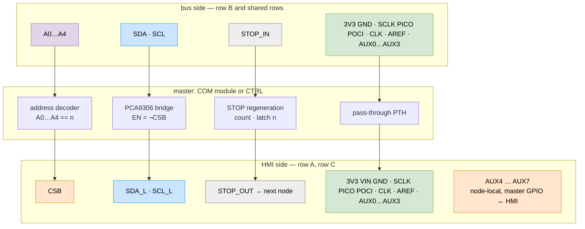
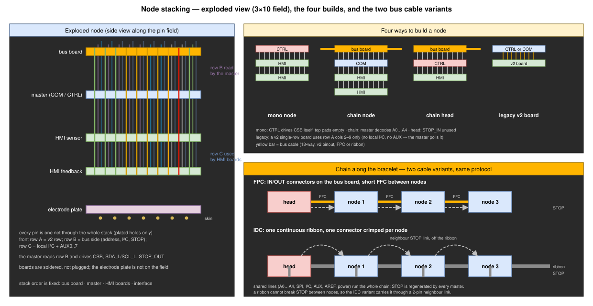
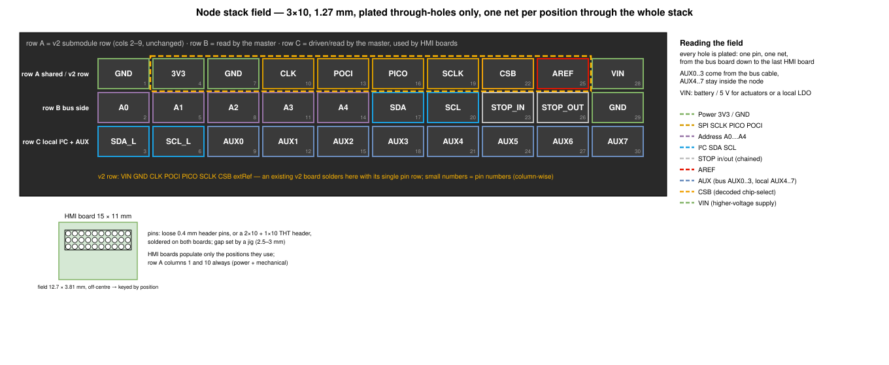

# Node stack interface — one footprint for bus board, master and HMI boards

Companion to [README.md](README.md) (bus lines and protocol). This file fixes
the **single soldered 3×10 pin field** (plated holes only) shared by every
board of a node, so that a bus board, a COM module or a CTRL node, and any
number of HMI submodules stack on the same pattern.


## 1. What the bus is, what the HMI side is

The bus (v2 and v3 alike) carries:

| Group | Lines | Count |
| --- | --- | :-: |
| Chip-select addressing | `A0`…`A4`, parallel, driven by the controller | 5 |
| Shared SPI | `SCLK`, `PICO`, `POCI` | 3 |
| Shared I²C | `SDA`, `SCL` (also the enumeration clock / ready flag) | 2 |
| In/out serial | `STOP_IN` → `STOP_OUT`, regenerated by every master (enumeration token) | 1 on the cable, 2 on the master |
| AUX | `AREF` (analog reference), `AUX0`, `AUX1` | 3 |
| Power | `3V3`, `GND` | 2 (+ duplicates) |

The HMI side is the v2 submodule row (`3V3`, `GND`, `CLK`, `POCI`, `PICO`,
`SCLK`, `CSB`, `extRef`) plus the node-local I²C segment and a few
per-node control lines.



Only the **master** (COM or CTRL) reads the bus. Between its two faces it:

- decodes `A0`…`A4` (row B) into `CSB` (row A, position 8),
- bridges shared `SDA`/`SCL` (row B) to the local `SDA_L`/`SCL_L` (row C)
  with a PCA9306, `EN` = `¬CSB` — a CTRL simply straps them,
- regenerates `STOP_IN` → `STOP_OUT` (both row B),
- passes everything else straight through.

## 2. Stack order and rows



```
   ┌────────────────┐
   │   bus board    │  FPC×2 or IDC tap        optional: absent on a mono node
   └───────┬────────┘   connects rows A + B (+ AUX0..3)
   ┌───────┴────────┐
   │ COM  or  CTRL  │  master: reads row B, drives CSB, SDA_L/SCL_L, STOP_OUT
   └───────┬────────┘
   ┌───────┴────────┐
   │ HMI (sensor)   │  uses row A (+ row C lines it needs), pass-through
   └───────┬────────┘
   ┌───────┴────────┐
   │ HMI (feedback) │
   └───────┬────────┘
   ┌───────┴────────┐
   │ interface /    │  electrode contacts, not on the pin field
   │ electrodes     │
   └────────────────┘
```

Every position is a **plated through-hole carrying one net through the whole
stack**; a single pin can run from the bus board down to the last HMI board.
A board simply connects the positions it uses and leaves the others as
pass-through holes. No board has different nets on its two faces, so no
special pads are needed. The master is the only board that *consumes* row B
and *produces* CSB, `SDA_L`/`SCL_L` and `STOP_OUT` — on different positions.

Stack order is fixed: bus board, master, HMI boards, interface. A CTRL used as
a mono node has nothing above it.

## 3. Footprint

| Item | Value |
| --- | --- |
| Pattern | **3×10, 1.27 mm pitch, 12.7 × 3.81 mm**, all PTH (1.0 mm pad, 0.65 mm drill); `clvhd_stack:CLVHD_STACK_3x10` |
| Numbering | column-wise: column *c* = pins 3c−2 (row A), 3c−1 (row B), 3c (row C) |
| Row A | shared lines, **the v2 submodule row in columns 2–9**, power at both ends |
| Row B | bus side: address, shared I²C, STOP chain |
| Row C | node-local I²C and eight generic AUX lines |
| Joint | loose 0.4 mm header pins or a 2×10 + 1×10 THT header, soldered on both boards; gap set by a jig |
| Population | per pin; row A columns 1 and 10 always (power, mechanical) |
| Keying | by placement: the field is off-centre on the short axis of the 15 × 11 mm outline |
| Template | one KiCad template for all boards (`pcb/config_file/templates/`, to be created) |

## 4. Position table



| Col | Row A (pin 3c−2) — shared | Row B (pin 3c−1) — bus side | Row C (pin 3c) — local / AUX |
| :-: | --- | --- | --- |
| 1 | `GND` | `A0` | `SDA_L` |
| 2 | `3V3` (v2 `VIN`) — **v2 row start** | `A1` | `SCL_L` |
| 3 | `GND` | `A2` | `AUX0` |
| 4 | `CLK` (v2 `CLK`) | `A3` | `AUX1` |
| 5 | `POCI` | `A4` | `AUX2` |
| 6 | `PICO` | `SDA` (shared segment) | `AUX3` |
| 7 | `SCLK` | `SCL` (shared segment) | `AUX4` |
| 8 | `CSB` (decoded chip-select) | `STOP_IN` | `AUX5` |
| 9 | `AREF` (v2 `extRef`) — **v2 row end** | `STOP_OUT` | `AUX6` |
| 10 | `VIN` | `GND` | `AUX7` |

- **`VIN`** is a higher-voltage supply (battery or 5 V) for boards that need
  more than the 3V3 rail: actuators, or a local LDO. A CTRL feeds it from its
  battery; on a chain node it is only present if the cable carries it (§6).
- **`AUX0`…`AUX3`** are the four AUX conductors of the bus cable, brought into
  the stack by the bus board. **`AUX4`…`AUX7`** never reach the cable: they are
  node-local lines between the master and its HMI boards.
- AUX lines have **no fixed function**. Each module declares in its README and
  `description.yaml` which AUX it uses and for what. Suggested conventions so
  boards interoperate by default: `AUX4` = ADC data-ready, `AUX5` = START /
  sync, `AUX6` = enable / reset release, `AUX7` = interrupt or second
  chip-select. `AUX0` = wired-OR data-ready on the bus, `AUX1` = sync
  broadcast.

## 5. Rules

- **Pass-through.** An HMI board connects only the positions it uses; every
  other hole is a plain pass-through. It never drives a row A line other than
  `POCI` while its `CSB` is low.
- **Master.** COM: reads `A0`…`A4`, drives `CSB`; bridges `SDA`/`SCL` to
  `SDA_L`/`SCL_L` (PCA9306, `EN` = `¬CSB`); regenerates `STOP_IN` →
  `STOP_OUT`. CTRL: drives `A0`…`A4`, `STOP_OUT`, `CSB` directly; connects
  `SDA_L` to `SDA` and `SCL_L` to `SCL` on its own board; leaves `STOP_IN` open.
- **Local I²C.** All HMI I²C devices sit on `SDA_L`/`SCL_L`; identical
  addresses on different nodes are fine. 10 kΩ pull-ups on the master.
- **AUX.** A master exposes `AUX4`…`AUX7` on GPIO and `AUX0`…`AUX3` on
  ADC-capable pins where possible. Two boards in one node must not both drive
  the same AUX.
- **Power.** Row A columns 1, 3 and row B column 10 are `GND`; row A columns
  2 and 10 are `3V3` and `VIN`. Draw actuator current from `VIN`, never `3V3`.
- **v2 boards on a v3 master.** They use row A columns 2–9 only: no local
  I²C, no AUX; the master polls them.

**Profiles** (declared in `description.yaml`):

| Profile | Positions | Typical board |
| --- | --- | --- |
| `H-v2` | A2–A9 | existing v2 submodules, single row |
| `H-spi` | A1–A10 + the AUX it uses (typically `AUX4`, `AUX5`) | `EMG_DAQ_ADS129x`, SPI IMU |
| `H-i2c` | A1, A2, A3, A10 + C1, C2 (+ `AUX6`, `AUX7`) | `VIB_DRV2625`, I²C sensor |
| `H-pwr` | A1–A3, A10 (`VIN`) + AUX | `VIB_STSPIN240`, `FES_*` |
| `B-bus` | rows A + B, C3–C6 (`AUX0`…`AUX3`) | bus boards |
| `M-full` | all 30 | masters |

## 6. Bus cable

The bus board maps the B face to the cable. `STOP_IN`/`STOP_OUT` collapse to
one conductor, regenerated by the master. The cable keeps the **v2 18-way
pinout unchanged**, so existing controller shields (`S_XIAO`, `S_PICO`,
`S_TEENSY4`) and v2 `COM_MOD` nodes can sit in the same chain as v3 nodes:

| Pin | Line | Pin | Line | Pin | Line |
| :-: | --- | :-: | --- | :-: | --- |
| 1 | `AUX1` → `AUX0` (C3) | 7 | `A2` | 13 | `STOP` (v2 `IO1`) → B8 / B9 |
| 2 | `3V3` | 8 | `A3` | 14 | `IO2` → `AUX3` (C6) |
| 3 | `GND` | 9 | `A4` | 15 | `SDA` |
| 4 | `AUX3` → `AUX2` (C5) | 10 | `POCI` | 16 | `SCL` |
| 5 | `A0` | 11 | `PICO` | 17 | `AUX2` → `AUX1` (C4) |
| 6 | `A1` | 12 | `SCLK` | 18 | `extRef` → `AREF` |

All four cable AUX conductors reach the stack as `AUX0`…`AUX3`. `VIN` has no
conductor on the v2 cable and ends on a test pad of the bus board; a v3 cable
may reuse the `AUX3` conductor (cable pin 4) for it. On the FPC bus board the OUT connector is pin-reversed
relative to IN, as in v2. On the IDC bus board (2×9 on an 18-conductor ribbon,
same order) `STOP` leaves the ribbon and uses the neighbour link (bus §8.10).

## 7. Compatibility matrix

| Device ↓ / master → | CTRL (mono) | COM v3 A/B | COM v2 (`COM_MOD`) |
| --- | :-: | :-: | :-: |
| HMI `H-v2` (existing single-row boards) | ✓ | ✓ | ✓ |
| HMI `H-spi` | ✓ | ✓ | ✗ (v2 stack lacks row B) |
| HMI `H-i2c` | ✓ | ✓ via PCA9306 | ✗ |
| Bus board FPC / IDC | ✓ | ✓ | ✓ same cable pinout |
| HMI `H-pwr` on `VIN` | ✓ (battery) | only with a v3 cable carrying `VIN` | ✗ |
| v2 controller shield as chain head | — | ✓ | ✓ |

## 8. Metadata

```yaml
interfaces:
  stack:
    role: hmi            # hmi | master | busboard
    profile: H-spi       # H-v2 | H-spi | H-i2c | H-pwr | B-bus | M-full
    pins: [1,4,7,10,13,16,19,22,25,28,21,24]   # column-wise numbers of the 3x10
    aux: {AUX4: DRDY#, AUX5: START}            # what this board puts on each AUX it uses
    cs_select: jumper    # SPI devices: jumper | A | B
```
