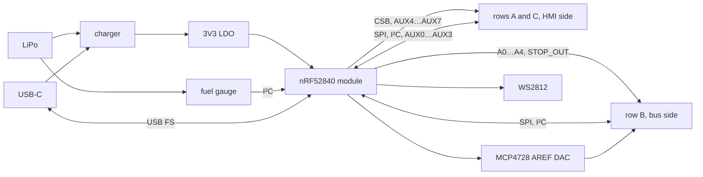

# CTRL_NRF52840 — nRF52840 controller node

> **Status:** KiCad project created with a generated draft schematic (all parts placed with values and nets attached by labels, no wiring tidy-up, empty PCB). Generator: `scripts/boards.py`. Plots below appear after running the jobset.

Controller in node form factor on the 3×10 stack field: HMI
submodules solder underneath (mono node), a bus board on top makes it the
head of a chain. nRF52840 candidate of the nRF-versus-ESP32-S3 comparison
(autonomy, link throughput, SPI performance). See
[`docs/bus/interfaces.md`](../../../../docs/bus/interfaces.md).

## Function

- **Mono role**: drives `CSB` directly, `SDA_L`/`SCL_L` strapped to `SDA`/`SCL`
  on the board (no bridge), `AUX4`…`AUX7` on GPIO for data-ready, start,
  enable and interrupt by convention, `AUX0`…`AUX3` on ADC-capable pins,
  `VIN` fed from the battery.
- **Head role**: drives `A0…A4`, `STOP_OUT`, runs enumeration with `SCL` as
  GPIO clock (any pin can be TWI on nRF52). `STOP_IN` unused.
- **Radio**: BLE 5 (2M PHY) and USB FS for the wired reference.
- **Power**: single-cell LiPo, USB charge, gauge for the autonomy measurements.

## Key parts

| Function | Part | Notes |
| --- | --- | --- |
| MCU module | Raytac MDBT50Q-1MV2 (10.5 × 15.5 mm) | pre-certified, chip antenna; alternative Holyiot 18010 (~10 × 14 mm) if width is critical |
| LiPo charger | MCP73831T-2ACI/OT (as `MONO_CTRL`) | 500 mA max, SOT-23-5 |
| Fuel gauge | BQ27421YZFR-G1A (as `XIAO_COM`) + 10 mΩ sense (G1A uses external sense) | DSBGA-9 |
| 3V3 LDO | MIC5504-3.3YM5 (as `MONO_CTRL`) | 300 mA is enough for nRF + one node |
| USB-C receptacle | 16-pin USB 2.0 type C (e.g. HRO TYPE-C-31-M-12) | 5.1 kΩ CC pull-downs |
| USB ESD | USBLC6-2SC6 | SOT-23-6 |
| AREF DAC | MCP4728A0T-E/UN (as the shields) | optional, I²C |
| LED | WS2812C-2020-V1 | |
| Buttons | TS-1088R-02026 ×2 (reset, user) | |
| Battery connector | JST SH 1.0 mm 2-pin (SM02B-SRSS-TB) or PH 2.0 mm | |
| Programming | SWD pads (SWDIO, SWCLK, RESET) | Tag-Connect TC2030 footprint |

## Electrical schematic

## PCB layout
| top | bottom |
| --- | --- |
|  |  |

## 3D model
[CTRL_NRF52840_3D](plots/CTRL_NRF52840_pcb.stl)
