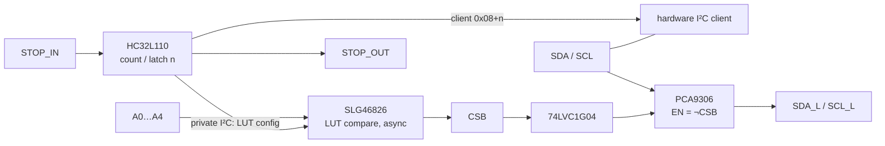

# COM_MOD_PAK — v3 communication module, version B (HC32L110 + SLG46826)

> **Status:** KiCad project created with a generated draft schematic (all parts placed with values and nets attached by labels, no wiring tidy-up, empty PCB). Generator: `scripts/boards.py`. Plots below appear after running the jobset.

Master of a chain node. Keeps the HC32L110 and its v2 enumeration firmware;
the 74HC688 comparator is replaced by an SLG46826 GreenPAK whose LUTs are
written at runtime over a **private** 2-wire link from two of the freed GPIOs.
Carries the 3×10 stack field (see
[`docs/bus/interfaces.md`](../../../../docs/bus/interfaces.md)).

## Function

- **Enumeration**: v2 firmware untouched except `set_address()`, which writes
  the PAK LUTs instead of five GPIOs. Pin map: SDA P35, SCL P36, STOP_IN P31,
  STOP_OUT P02, LED P01, PAK link P34/P33, AUX4 P03, AUX5 P15, AUX6 P14,
  AUX7 P32, user button P23, SWDIO P27, reset P00.
- **Decode**: 4-bit LUT one-hot on `A0…A3`, 2-bit LUT on `A4`, 3-bit LUT AND +
  invert. Blank / pre-init pattern decodes "never match". No oscillator, no
  DFF; quiescent < 1 µA.
- **Private link**: bit-banged I²C on two GPIOs to the PAK only, so the shared
  bus never sees the PAK and every PAK keeps its factory address.
- **I²C bridge, STOP, LED, re-enumeration**: as `COM_MOD_PIC`.

## Stack field (3×10, all PTH)

Same pin usage as `COM_MOD_PIC`; `AUX4`…`AUX7` on HC32L110 GPIOs P03/P15/P14/P32.

## Key parts

| Function | Part | Package |
| --- | --- | --- |
| MCU | HC32L110C6UA (as `COM_MOD`; the CSP-16 variant is not routable with JLC rules) | QFN-20 3×3 0.4 mm |
| Address decoder | SLG46826V | STQFN-20 2×3 0.4 mm |
| I²C bridge | PCA9306DQER | X2SON-8 1.4×0.8 |
| CSB inverter | SN74LVC1G04DPWR | X2SON-4 0.8×0.8 |
| LED | WS2812C-2020-V1 | 2.0×2.0 |
| Button | TS-1088R-02026 | SMD |
| Programming | SWD: SWDIO, SWCLK, reset pads | — |

Decoupling 100 nF + 1 µF 0402 per IC; pull-ups as for version A; 4.7 kΩ on the
private link.

## Bench before layout

- Decode propagation at 3.3 V on a GreenPAK dev board.
- LCSC / JLC stock of SLG46826V before committing to assembly.

## Electrical schematic

## PCB layout
| top | bottom |
| --- | --- |
|  |  |

## 3D model
[COM_MOD_PAK_3D](plots/COM_MOD_PAK_pcb.stl)
