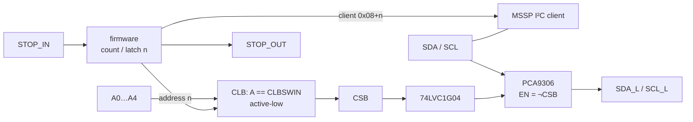

# COM_MOD_PIC — v3 communication module, version A (PIC16F13145)

> **Status:** KiCad project created with a generated draft schematic (all parts placed with values and nets attached by labels, no wiring tidy-up, empty PCB). Generator: `scripts/boards.py`. Plots below appear after running the jobset.

Master of a chain node. Replaces the HC32L110 + 74HC688 pair of `COM_MOD` with
one PIC16F13145 whose Configurable Logic Block (CLB) does the 5-bit address
compare. Carries the 3×10 stack field: bus board above, HMI
submodules below (see [`docs/bus/interfaces.md`](../../../../docs/bus/interfaces.md)).

## Function

- **Enumeration**: port of the v2 firmware. `SCL` is a GPIO with edge interrupt
  until addressed, then handed to the MSSP. `SDA` driven low until addressed.
- **Decode**: static CLB bitstream, equality between `A0…A4` and five software
  input bits (`CLBSWIN`); the firmware writes the address once. CLB stays
  disabled until addressed so address 0 never matches.
- **I²C bridge**: PCA9306 between shared and local segments, enabled by the
  inverted `CSB`. Local pull-ups 10 kΩ.
- **STOP**: `STOP_IN` on an input, `STOP_OUT` driven low once addressed.
- **LED**: one WS2812 driven by the PIC (status: blinks per counted edge, then
  address colour). Not on the bus.
- **Re-enumeration**: I²C general call resets to the initial state (v3 protocol).

## Stack field (3×10, all PTH)

| Role | Positions |
| --- | --- |
| row B (read) | `A0`…`A4`, `SDA`/`SCL`, `STOP_IN` |
| driven | `CSB` (A8), `SDA_L`/`SCL_L` (C1/C2), `STOP_OUT` (B9) |
| AUX | `AUX4`…`AUX7` on GPIO (node-local); `AUX0`…`AUX3` pass through |

## Key parts

| Function | Part | Package |
| --- | --- | --- |
| MCU + CLB | PIC16F13145, 20-pin VQFN 3×3 (`-I/REB`) | VQFN-20 0.4 mm |
| I²C bridge | PCA9306DQER | X2SON-8 1.4×0.8 |
| CSB inverter | SN74LVC1G04DPWR | X2SON-4 0.8×0.8 |
| LED | WS2812C-2020-V1 | 2.0×2.0 |
| Button (user / reset) | TS-1088R-02026 | SMD |
| Programming | ICSP: PGD, PGC, MCLR pads (Tag-Connect TC2030 footprint or 3 pads) | — |

Decoupling 100 nF + 1 µF 0402; 10 kΩ pull-ups on `CSB`, `EN`, local I²C; 200 kΩ
`VREF2` pull-up for the PCA9306.

## Bench before layout

- CLB decode propagation at 3.3 V on the PIC16F13145 Curiosity Nano (EV06M52A).
- Confirm how the CLB bitstream is loaded (flash vs RAM) so the address path via `CLBSWIN` is the one used.

## Electrical schematic

## PCB layout
| top | bottom |
| --- | --- |
|  |  |

## 3D model
[COM_MOD_PIC_3D](plots/COM_MOD_PIC_pcb.stl)
